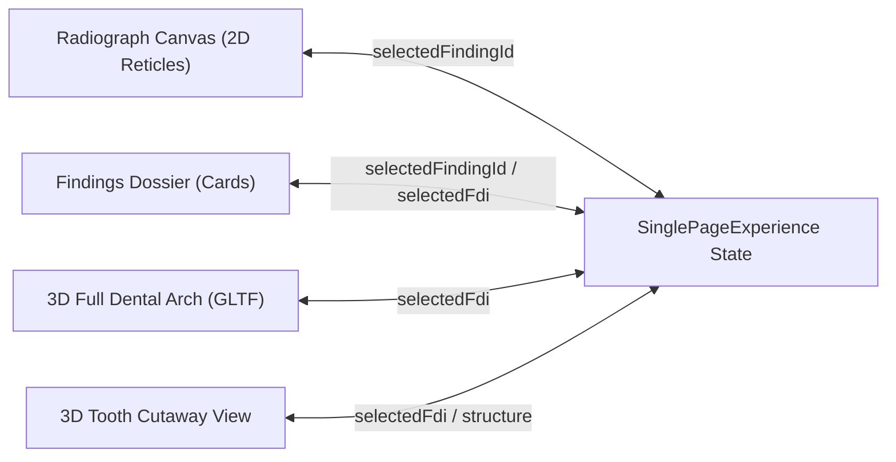

# LEVEL 20 — 3D ANATOMICAL MODEL SYNCHRONIZATION TESTS & EVIDENCE

> **DOCUMENT ID:** DOC-L20-SYNC-004  
> **TOPIC:** Verification of Multi-View Synchronized State across 2D X-Ray, 3D Arch, and Cutaway  
> **DATE:** 2026-11-21  

---

## 1. Overview of Synchronization Architecture

DENTRACE implements a single shared interaction state across all radiograph and 3D visualization panes:

When a user or AI finding selects an FDI tooth:
1. The 2D radiograph reticle changes from yellow (`#EAB308` / `#FACC15`) to high-contrast cyan/blue (`#0284C7`) indicating active focus.
2. The corresponding item in the findings dossier expands with an active highlight border (`#4F8175`).
3. The 3D Dental Arch rotates/focuses and highlights the target tooth mesh in primary teal (`#0F766E`).
4. The 3D Tooth Anatomy Cutaway viewer updates its tooth header and anatomical tissue selector.

---

## 2. Test Execution & Observed Transitions

Headless browser tests on `http://127.0.0.1:5173/` verified the following state transitions:

### Transition 1: Neutral Initial State -> Initial Finding Auto-Selection
- **Action:** Clinician loads verified study `CASE-D49166F1`.
- **Initial State:** `selectedFdi = null`, `selectedFindingId = null`.
- **Target Finding:** `FND-64F84929` (FDI #42, Periapical Lesion, Conf: 74%).
- **Verification:**
  - 2D Canvas: Bounding box around apical root of mandibular right incisor turns active cyan.
  - 3D Model: Tooth #42 is illuminated; info bar displays:
    `FDI #42 · Mandibular Right Lateral Incisor · periapical lesion (74%)`.
  - Evidence Screenshot: `browser_sandbox/screenshots/step_33_shot_1.png`.

### Transition 2: Finding Dossier Selection -> Cross-View Synchrony
- **Action:** Clinician clicks on finding card for `FDI #35 · Caries (47%)` (`FND-22808D6D`).
- **Target FDI:** Tooth 35 (Mandibular Left Second Premolar).
- **Verification:**
  - 2D Canvas: Crown reticle at lower left premolar becomes highlighted.
  - Findings List: Card #3 becomes active with green/teal focus border.
  - 3D Model: Dental arch highlights tooth #35 in the lower left quadrant; info bar updates to:
    `FDI #35 · Mandibular Left 2nd Premolar · caries (47%)`.
  - Evidence Screenshot: `browser_sandbox/screenshots/step_35_shot_1.png`.

### Transition 3: Full Arch View -> Tooth Anatomy Cutaway View
- **Action:** Clinician toggles 3D mode from "Full Dental Arch" to "Tooth Anatomy".
- **Verification:**
  - Viewport switches from complete 28-tooth arch to isolated multi-layer cutaway mesh showing enamel, dentin, and pulp chamber.
  - Tooth header indicates active correlation with FDI #35.
  - Evidence Screenshot: `browser_sandbox/screenshots/step_37_shot_1.png`.

---

## 3. Clinical Safety Assertions

1. **Non-Invention Rule:** Selecting a tooth manually on the 3D arch or odontogram NEVER generates an AI finding or creates a fake pathology detection.
2. **Educational Disclaimer:** Both the Full Dental Arch and Tooth Anatomy viewports maintain the permanent disclaimer:
   *"Reference 3D Dental Anatomy — Not Patient-Specific"*.
3. **Lesion Depth Truthfulness:** Selecting an anatomical tissue (e.g., dentin, pulp) in the cutaway viewer does NOT claim that a cavity penetrates that layer unless confirmed by the clinician or proven by validated lesion-level segmentations.
