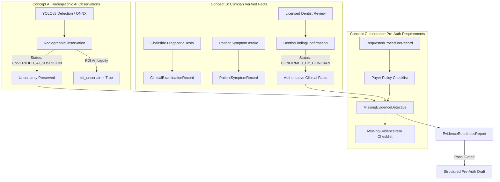

# DENTRACE Level 4: Deterministic Clinical Evidence Engine & Concept Separation

**Document ID:** `DOC-ENG-L4-001`  
**Date:** 2026-10-20  
**Status:** COMPLETE & AUTHORITATIVE  
**Notice:** *"Draft for dentist review. Not a diagnosis. Academic college decision-support system. Not an FDA/CE/MDR certified medical device."*

---

## 1. Architectural Mission & Clinical Governance

The Level 4 Clinical Evidence Engine operates under an unconditional architectural constraint:
**Deterministic Clinical Fact Authority Precedes Language Model Narrative Generation.**

In conventional generative AI architectures, raw visual predictions or free-form prompts are passed directly to an LLM, delegating medical reasoning, anatomy validation, and diagnostic truth to statistical token prediction. In DENTRACE, this design is formally rejected as medically unsafe.

The Clinical Evidence Engine (`backend/clinical/evidence_engine.py` and `backend/services/clinical_service.py`) acts as the authoritative gatekeeper. It runs **BEFORE** any call to the local Ollama daemon or deterministic narrative generator. Its responsibilities are strictly deterministic:
1. Enforces three-way conceptual separation between AI observations, clinician findings, and payer requirements.
2. Identifies unconfirmed, ambiguous, or shifted tooth numbering proposals from upstream detectors.
3. Detects direct clinical contradictions between proposed procedures and recorded findings.
4. Audits completeness against evidence checklist requirements.
5. Computes a transparent checklist completeness score (0–100%) labeled explicitly as **documentation completeness, NOT approval probability**.
6. Blocks claim pack exportation if target teeth remain unconfirmed by a licensed dentist.

---

## 2. Three-Way Concept Separation Schema

To prevent unverified machine inferences from silently coalescing into accepted clinical reality, the system represents evidence using strongly typed Pydantic models across three disjoint layers:

### 2.1. Concept A: AI Radiographic Observations (`RadiographicObservation`)
- **Source Type:** `EvidenceSource.AI_RADIOGRAPHIC_OBSERVATION`
- **Initial Verification Status:** `VerificationStatus.UNVERIFIED_AI_SUSPICION`
- **Fields:**
  - `evidence_id`: Canonical identifier `EVID-RAD-[UUID8]`
  - `finding_id`: Upstream finding reference
  - `pathology_candidate`: Model candidate class (`caries`, `deep_caries`, `periapical_lesion`, `impacted_tooth`)
  - `confidence`: Raw probability score (0.0 to 1.0)
  - `calibrated_confidence`: None (calibrated only if verified by empirical isotonic calibration)
  - `annotation_modality`: `instance_segmentation` vs `detection_bounding_box`
  - `geometry_semantics`: `"abnormal_tooth_boundary"` (distinguishing abnormal tooth masks from cavity margins)
  - `tooth_fdi`: 11–48 or `None` if unassigned
  - `fdi_uncertain`: Boolean flag indicating inter-tooth pitch ambiguity or serial shift
  - `fdi_uncertainty_reason`: Human-readable explanation of ambiguity

### 2.2. Concept B: Dentist-Confirmed Clinical Findings & Examinations
- **Confirmations (`DentistFindingConfirmation`):**
  - `evidence_id`: `EVID-CFM-[UUID8]`
  - `reviewer_name` & `license_number`: Verified practitioner identity
  - `decision`: `ReviewDecision.CONFIRMED`, `REJECTED`, or `MODIFIED`
  - `confirmed_fdi`: Authoritative tooth number assigned by dentist
  - `confirmed_pathology`: Authoritative diagnosis selected by dentist
  - `clinical_notes`: Subjective practitioner observations
  - `verification_status`: `CONFIRMED_BY_CLINICIAN` or `REJECTED_BY_CLINICIAN`
- **Examinations (`ClinicalExaminationRecord`):**
  - `evidence_id`: `EVID-EXM-[UUID8]`
  - `pulp_vitality`: `'responsive'`, `'non_vital'`, `'delayed'`, or `'not_tested'`
  - `percussion_sensitivity`: Boolean
  - `probing_depth_mm`: Periodontal pocket depth (0.0 to 20.0 mm)
  - `mobility_grade`: 0 to 3
  - `visual_cavitation`: Structural enamel/dentin cavitation boolean
  - `defective_restoration`: Boolean margin integrity flag
  - `swelling_or_fistula`: Soft-tissue pathology flag
- **Symptoms (`PatientSymptomRecord`):**
  - `evidence_id`: `EVID-SYM-[UUID8]`
  - `chief_complaint`: Patient intake statement
  - `pain_character`: `'sharp'`, `'dull'`, `'throbbing'`, `'spontaneous'`, `'cold_sensitive'`, or `'none'`

### 2.3. Concept C: Insurance Documentation Requirements (`RequestedProcedureRecord` & `PayerPolicyTemplate`)
- **Requested Procedure (`RequestedProcedureRecord`):**
  - `procedure_id`: `PROC-[UUID8]`
  - `tooth_fdi`: Target tooth
  - `procedure_name`: e.g., `"Molar Endodontic Therapy"`
  - `suggested_cdt_code`: e.g., `"D3330"`
  - `cdt_code_verified_by_dentist`: Mandatory boolean attestation
  - `clinician_rationale`: Objective medical justification written by the dentist
  - `urgency`: `ROUTINE`, `SOON`, `URGENT`, `EMERGENCY`
- **Payer Policy Template (`PayerPolicyTemplate`):**
  - Modular checklist mapping specialty procedures (Endodontics, Restorative, Oral Surgery, Periodontics) to evidentiary requirements.

---

## 3. Deterministic Validation Engine Logic

The engine executes 7 sequential checks prior to document compilation:

| Stage | Check Description | Pass Criteria | Failure Consequence |
|---|---|---|---|
| **1** | **Radiographic Evidence** | Local raster file exists on disk and is accessible | `failed_checks.append("Radiographic image file missing")` |
| **2** | **FDI Tooth Confirmation** | All target procedure teeth are explicitly confirmed by clinician without uncertainty flags | Adds to `unconfirmed_tooth_ids`; flags `BLOCKED_BY_UNCONFIRMED_TOOTH` |
| **3** | **Clinician Review Coverage** | Zero pending unreviewed AI findings | Informs preflight checklist completeness score |
| **4** | **Procedure Selection** | At least one procedure formally selected by clinician | Blocks draft generation (`INCOMPLETE_DOCUMENTATION`) |
| **5** | **Clinician Treatment Rationale** | Non-empty objective rationale ($\ge 10$ characters) | Added to missing checklist items |
| **6** | **Contradiction Detection** | Zero factual or clinical contradictions | Populates `contradictions_detected`; blocks final export |
| **7** | **Detective Requirements** | Missing Evidence Detective finds zero unmet checklist items | Computes checklist completeness percentage |

### Contradiction Detection Rules:
1. **Rejected Finding Contradiction:** If a clinician marks finding $X$ as `REJECTED`, but subsequently selects a procedure aimed at treating finding $X$ on that same tooth, the engine flags a fatal contradiction.
2. **Vital Pulp Endodontics Contradiction:** If endodontic therapy (`D3330`/`D3320`) is requested for a tooth documented as `pulp_vitality = "responsive"` without radiographic deep caries or periapical lesion, an immediate contradiction is raised.
3. **Anatomy vs. Procedure CDT Mismatch:** If CDT code `D3330` (molar endodontics) is selected for a premolar tooth (position 4 or 5), the engine flags a anatomical code inconsistency.

---

## 4. Documentation Readiness Preflight States

The engine outputs an authoritative `EvidenceReadinessReport` containing one of 6 mutually exclusive preflight states:

| Status Code | Meaning | Can Draft LLM? | Can Export PDF Claim Pack? |
|---|---|:---:|:---:|
| `BLOCKED_BY_UNCONFIRMED_TOOTH` | Target tooth is unassigned, uncertain, or shifted | **NO** | **NO** |
| `INCOMPLETE_DOCUMENTATION` | Contradictions exist or compulsory facts missing | **YES** *(Incomplete Review Draft)* | **NO** |
| `REQUIRES_ADDITIONAL_EVIDENCE` | Recommended clinical context absent (symptoms, etc.) | **YES** | **NO** |
| `REQUIRES_CODE_VERIFICATION` | CDT code proposed but not attested by dentist | **YES** | **NO** |
| `READY_FOR_CLINICIAN_REVIEW` | All checklist items satisfied; awaiting final sign-off | **YES** | **NO** |
| `REVIEWED_DRAFT_READY_FOR_EXPORT` | Confirmed by dentist, complete checklist ($\ge 90\%$) | **YES** | **YES** *(Submission Ready)* |

> [!CAUTION]
> Under no circumstances does the system output `INSURANCE_APPROVED`. Claim pre-authorization decisions reside exclusively with external third-party payers.
