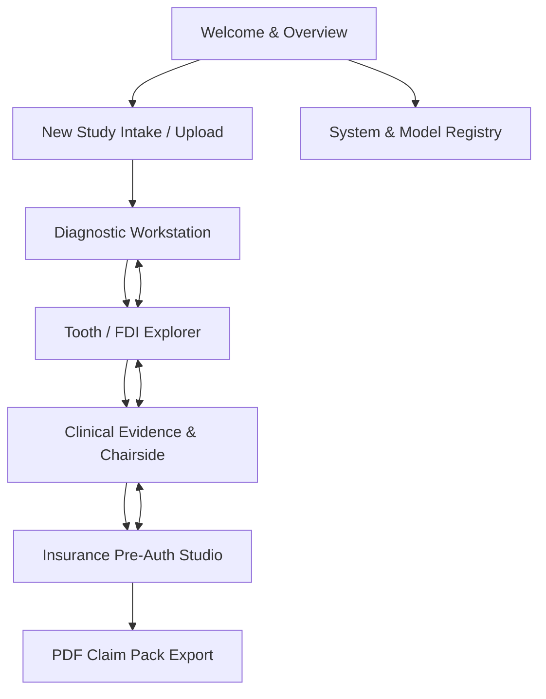

# DENTRACE — Level 5 Frontend Design & Architecture

**Classification:** Clinical Decision-Support Workstation (Academic College Prototype)  
**Regulatory Notice:** "Draft for dentist review. Not a diagnosis." Not an FDA/CE/MDR certified medical device.  
**Frontend Framework:** Streamlit 1.39+ with high-performance bidirectional HTML5 Canvas components.  
**Host Binding:** Strictly local-first (127.0.0.1:8501, 127.0.0.1:8000, 127.0.0.1:11434). Zero cloud telemetry.

---

## 1. Executive Summary & Design Philosophy

Level 5 transitions DENTRACE from a headless clinical intelligence backend into a **state-of-the-art interactive clinical workstation**. Rather than employing generic SaaS card templates or typical brightly saturated AI dashboards, DENTRACE introduces the **Curie-Nordic Dark Obsidian** design language.

Curie-Nordic is purpose-built for clinical diagnostic workstations:
1. **Glare-Free Diagnostic Canvas:** Built on deeply dark obsidian surfaces (`#070A0D`, `#0D1217`, `#131B22`) to maximize radiographic contrast sensitivity and eliminate clinician eye fatigue in darkened reading rooms.
2. **Medical Radiograph Sanctity:** Under no circumstances are diagnostic X-ray pixels modified, filtered, stylized, or dynamically pulsed for aesthetic animation.
3. **Okabe-Ito Colorblind-Safe Pathology Spectrum:** Every diagnostic finding category uses an accessible, perceptually distinct hue that remains identifiable under deuteranopia, protanopia, and tritanopia.
4. **Clinical Safety & Separation of Powers:** Unconfirmed AI proposals are visibly segregated from human dentist-attested ground truth. Mandatory regulatory disclaimers persist across every screen.

---

## 2. Research & Evaluation of Visual Directions

Using the installed `ui-ux-pro-max` design intelligence skill (`C:\Users\krish\.gemini\config\skills\ui-ux-pro-max\SKILL.md`), three competing design directions were systematically evaluated:

| Criterion | Direction A: Modern Enterprise Soft UI | Direction B: Swiss Medical High-Contrast Clean | Direction C: Curie-Nordic Dark Obsidian (Selected) |
| :--- | :--- | :--- | :--- |
| **Theme / Archetype** | Light gray/slate, subtle drop-shadows | Bright clinical white, stark black typography | Deep obsidian slate, technical glowing accents |
| **Visual Originality** | 5/10 (Common SaaS look) | 7/10 (Clinical and stark) | **9/10 (Distinctive PACS diagnostic identity)** |
| **Radiograph Usability** | 4/10 (Glare around X-ray canvas) | 6/10 (Stark white border causes retinal glare) | **10/10 (Glare-free OLED slate; optimal dynamic range)** |
| **Colorblind Safety** | 6/10 (Standard red/amber/green) | 7/10 (High contrast but limited spectrum) | **10/10 (Full Okabe-Ito verified palette)** |
| **Streamlit Feasibility** | 8/10 (Easy CSS card override) | 8/10 (Clean table layouts) | **9.5/10 (Seamless dark mode, custom canvas)** |
| **Cognitive Density** | Low (Spread out cards) | Medium (Dense tables) | **Optimized 9/10 (High density without clutter)** |
| **Motion Guidelines** | Bouncy UI animations | Minimalist (No animations) | **Deliberate micro-transitions (150ms); zero on pixels** |

### Selected Direction: Curie-Nordic Dark Obsidian
*Direction C was chosen* because medical imaging interpretation demands a dark background to preserve subtle gray level differences in dental radiographs (e.g. enamel demineralization, lamina dura thinning, trabecular pattern changes). White or light grey backgrounds constrict clinician pupils and reduce visual sensitivity to low-contrast radiolucencies.

---

## 3. Design System & Token Architecture

### 3.1 Surface & Border Palette
- **Radiograph Canvas Surface:** `#070A0D` (Pure OLED deep charcoal)
- **Application Shell & Sidebar:** `#0D1217` (Deep slate)
- **Primary Panel & Container:** `#131B22` (Elevated slate)
- **Elevated Card & Row Hover:** `#1A242E`
- **Subtle Divider / Border:** `#1E2A36`
- **Strong Structural Border:** `#2A3B4C`
- **Technical Accent Glow:** `#38BDF8` (`rgba(56, 189, 248, 0.15)`)

### 3.2 Typography Tokens
- **Display & Section Headers:** `Figtree`, sans-serif (Weights 600, 700; technical, refined, modern geometric).
- **Body & Clinical Descriptions:** `Noto Sans`, sans-serif (Weights 400, 500; high legibility for dense medical terms).
- **Technical Identifiers & FDI Codes:** `JetBrains Mono`, monospace (Clean tabular numbers for tooth numbering `#11–48`, CDT codes `D3330`, SHA-256 hashes, coordinates).

### 3.3 Okabe-Ito Colorblind-Safe Pathology Spectrum
- **Caries / Demineralization:** `#E67E22` (Accessible warm amber)
- **Deep Caries (Pulp Involvement):** `#E74C3C` (High-contrast red)
- **Periapical Lesion / Rarefaction:** `#CC79A7` (Okabe-Ito reddish purple)
- **Impacted Tooth / Eruption Failure:** `#F59E0B` (Bright amber)
- **Alveolar Bone Loss / Periodontitis:** `#38BDF8` (Sky blue)
- **Root Canal Restoration:** `#009E73` (Bluish green)
- **Uncertain / Ambiguous Identifier:** `#94A3B8` (Neutral slate)

---

## 4. Workstation Architecture & Page Flow

The application provides seven specialized, interconnected clinical views:

1. **Welcome & Overview:** Mission statement, live service heartbeat pills (FastAPI, Ollama `qwen2.5:3b`, NVIDIA RTX 2050), recent cases list, and quick launchpad.
2. **Study Intake / Upload:** Drag-and-drop OPG uploader, DICOM client-side de-identification notice, live raster preview, dimension checks, and database ingestion.
3. **Diagnostic Workstation:** Full 1:1 aspect-ratio high-DPI HTML5 Canvas OPG viewer with mouse pan, zoom, fit-to-screen, per-class opacity slider, true polygon vs bbox toggles, tooth hover tooltips, and real-time ONNX model screener trigger.
4. **Tooth / FDI Explorer:** Anatomical 32-tooth permanent odontogram partitioned into four quadrants (Maxilla Q1/Q2, Mandible Q4/Q3), tooth-level findings aggregation, and human dentist attestation controls.
5. **Findings & Clinical Evidence:** Progressive disclosure of model observations vs clinician confirmations, objective chairside test inputs (Cold Pulp Vitality, Percussion, Palpation, Probing Depth), patient symptoms, and tamper-resistant audit ledger.
6. **Insurance Pre-Authorization Studio:** CDT procedure selector (e.g. `D3330`, `D7210`, `D2740`), deterministic documentation readiness preflight, Missing Evidence Detective checklist, local Ollama narrative generation (offline `qwen2.5:3b` with Pydantic JSON schema constraints), 10 editable structured narrative sections, and ReportLab PDF claim pack export.
7. **System & Settings:** Real-time health status, SHA-256 cryptographic checksums for registered vision models, host VRAM/disk metrics, and local privacy boundaries.
